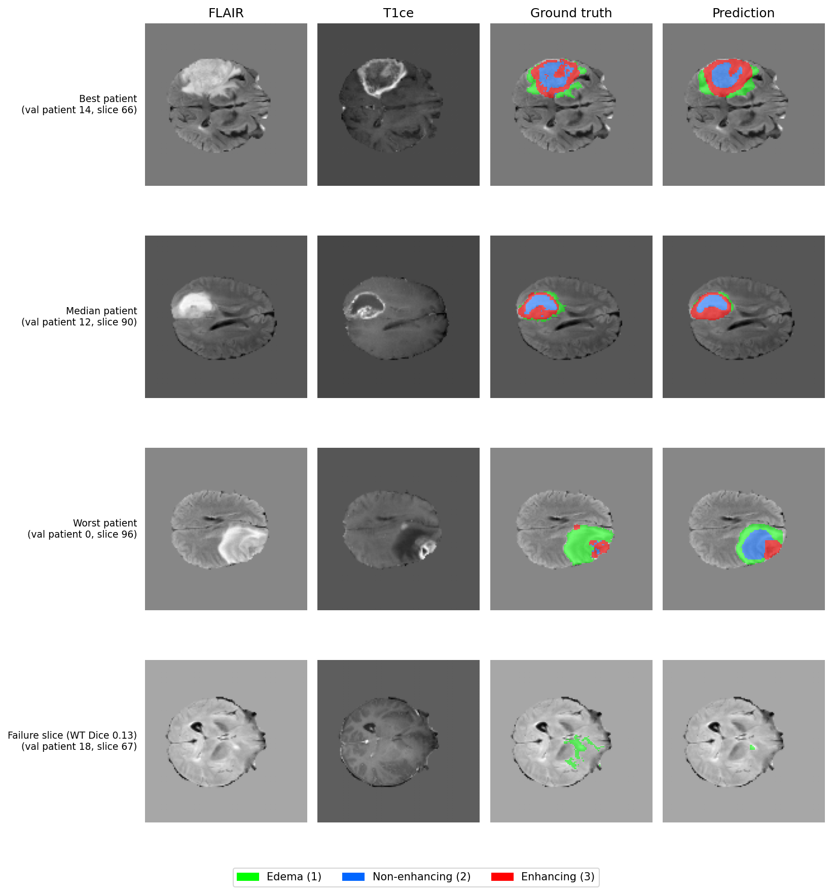

# EMCAD for 2D multi-class brain tumor segmentation (MSD BrainTumour)

Adaptation of [EMCAD](https://github.com/SLDGroup/EMCAD) (PVT-EMCAD-B2) to 2D multi-class segmentation of brain tumor
sub-regions from 4-channel multi-parametric MRI (axial slices), evaluated with per-patient 3D Dice and HD95 for
**Whole Tumor (WT)**, **Tumor Core (TC)** and **Enhancing Tumor (ET)**.

A short technical report is in [`report/EMCAD_BrainTumor_Report.docx`](report/EMCAD_BrainTumor_Report.docx).

## Results

Per-patient 3D metrics on 20 held-out validation patients (mean over patients; HD95 in mm):

| Region | Dice | HD95 (mm) |
|---|---|---|
| Whole tumor (WT) | 0.891 | 8.28 |
| Tumor core (TC) | 0.855 | 7.90 |
| Enhancing tumor (ET) | 0.780 | 5.94 |
| **Mean** | **0.842** | **7.37** |

Files: [`results/per_patient_metrics.csv`](results/per_patient_metrics.csv),
[`results/summary_metrics.csv`](results/summary_metrics.csv), training log in [`logs/train_log.txt`](logs/train_log.txt).
Two earlier notebook runs of the same pipeline gave mean Dice 0.841 / mean HD95 7.46 mm (no fixed seed) and
0.843 / 7.20 mm (seed 0), so the result is stable across runs.



*FLAIR, T1ce, ground truth and prediction for the best, median and worst patients (ranked by mean 3D Dice) and the
worst-performing tumor slice. Green = edema, blue = non-enhancing tumor, red = enhancing tumor.*

## What was done

1. **Dataloader** (`src/preprocess.py`, `src/dataset.py`): MSD Task01 volumes `(240, 240, 155, 4)` with channel order
   FLAIR, T1w, T1gd (T1ce), T2w. Per-modality z-score over brain voxels, axial slicing, resize to 128x128 (bilinear for
   images, nearest for labels). Training keeps all tumor slices plus 20% of tumor-free brain slices, with random flips.
   Patient-level split: first 80 training patients for training, first 20 labeled validation patients for validation.
2. **Model** (`src/model.py`): PVT-EMCAD-B2 with ImageNet-pretrained PVTv2-b2. Two changes only: the first patch-embedding
   conv is widened from 3 to 4 channels (4th = mean of the pretrained 3) and `num_classes=4` (background, edema,
   non-enhancing, enhancing) in all four segmentation heads with softmax. MSCAM blocks, LGAGs, EUCBs and skip connections
   are unchanged because they depend on feature-map channels, not on input channels or classes. WT = labels 1-3,
   TC = labels 2-3, ET = label 3 are derived from the predicted label map.
3. **Loss** (`src/losses.py`): 0.7 x Dice + 0.3 x cross-entropy on each of the four heads plus one term on the summed head
   logits.
4. **Training** (`train.py`): AdamW (lr 1e-4, wd 1e-4), cosine schedule, batch 16, mixed precision, 15 epochs, seed 0.
   Best epoch (epoch 14) chosen by mean pooled slice-level Dice on the validation set.
5. **Evaluation** (`evaluate.py`): each validation patient is predicted slice by slice, stacked into a 3D volume, and
   Dice / HD95 are computed per patient and averaged. Prediction = argmax of the sum of the four head logits.
6. **Overlays** (`visualize.py`): best / median / worst patient and the worst tumor slice.

## Reproduce

The reported numbers were produced by running the scripts below on a Kaggle GPU (seed 0). [`notebooks/`](notebooks/)
contains the reproducing code.

```bash
pip install -r requirements.txt
bash scripts/setup.sh            # clones official EMCAD into ./EMCAD and downloads PVTv2-b2 weights

# 1. preprocess (adjust the four paths to your MSD Task01 copy: imagesTr / labelsTr style folders)
python -m src.preprocess --train_images <train_images_dir> --train_labels <train_labels_dir> \
                         --val_images <val_images_dir> --val_labels <val_labels_dir> --out_dir data

# 2. train (about 13 minutes on one Kaggle GPU)
python train.py --data_dir data --epochs 15 --seed 0

# 3. evaluate (per-patient 3D Dice and HD95) and make the figure
python evaluate.py  --data_dir data --ckpt checkpoints/best.pth
python visualize.py --data_dir data --ckpt checkpoints/best.pth
```

Requirements: a CUDA GPU is recommended; internet access for `scripts/setup.sh`. Trained weights are not included in this
repository.

## Deviations from the EMCAD paper

- Input size 128x128 (paper: 224x224 for Synapse/ACDC) and 15 epochs (paper: 300-400 for multi-organ tasks), for speed.
- Simplified multi-head loss: each head plus the summed logits, instead of all 15 head combinations.
- Final prediction uses the sum of the four head logits; the paper uses only the last head (p4).
- Subset of the data: 80 of 250 training patients and 20 of the 100 labeled validation patients.

## Limitations

- Small subset, short training, low resolution, and results from three runs, so differences of about a point are not
  meaningful.
- The best epoch was selected on the same validation set that is reported (no separate test set), so numbers may be
  slightly optimistic.
- HD95 spacing is approximate (1 mm between slices, 240/128 mm in-plane after resizing).
- Mean HD95 is pulled up by a few patients (patient 15: 49.0 mm WT, 63.4 mm TC; patient 17: 31.9 mm WT; patient 0:
  23.1 mm TC, 24.6 mm ET); per-patient median HD95 is WT 4.00, TC 3.54, ET 3.82 mm. The cause of these outliers was
  not investigated.
- No 3D post-processing was applied.

## Acknowledgements

Built on the official [EMCAD](https://github.com/SLDGroup/EMCAD) implementation (Rahman, Munir, Marculescu, CVPR 2024),
which is not redistributed here, and PVTv2 pretrained weights from [whai362/PVT](https://github.com/whai362/PVT).
Data: [Medical Segmentation Decathlon](http://medicaldecathlon.com/), Task01 BrainTumour. EMCAD's own license applies to
its code.
